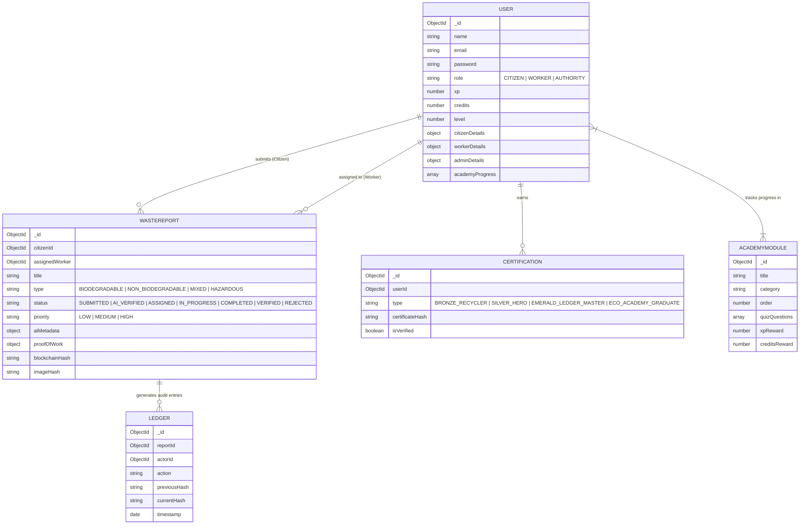
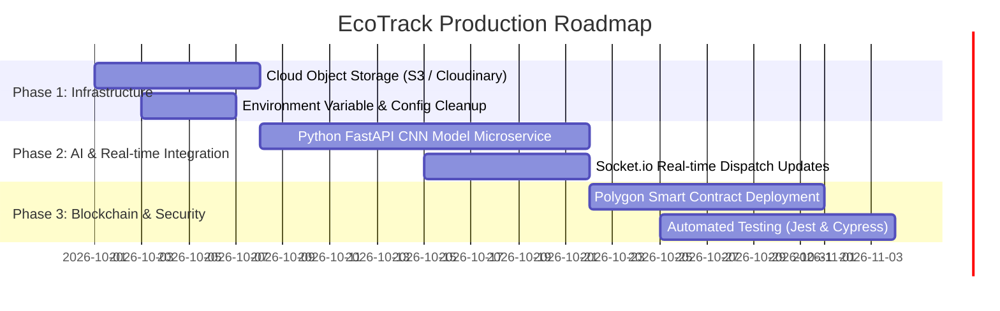

# 📊 EcoTrack - Comprehensive Project Analysis & Status Report

**Generated Date:** September 27, 2026  
**Project Name:** EcoTrack (De-Centralized & AI-Assisted Waste Management Platform)  
**Workspace Location:** `d:\Eco_Tracker`  

---

## Executive Summary

**EcoTrack** is a full-stack, multi-platform ecosystem designed to modernize urban waste management through AI image verification, cryptographic blockchain ledger auditability, municipal dispatching, field-worker task management, citizen gamification, and interactive environmental education.

The project is currently in an **Advanced Prototype / MVP State (~85-90% Complete)**. Core functional workflows—ranging from citizen report submission and AI fraud detection simulation to municipal worker dispatching, proof-of-work submission, quiz-based academy learning, and dynamic PDF certificate generation—are **fully implemented and operational across backend, web, and mobile platforms.**

📌 *A complete itemized feature and task checklist is maintained in [PROJECT_CHECKLIST.md](file:///d:/Eco_Tracker/PROJECT_CHECKLIST.md).*

---

## 🏗️ Architecture & Technology Stack

The repository is structured as a clean monorepo with three core sub-systems:

```
Eco_Tracker/
├── backend/    # Node.js + Express REST API with MongoDB & PDF/Canvas rendering
├── web/        # Vite 8 + React 19 Web Portal (Citizens, Workers, Authorities, Explorer)
└── mobile/     # React Native + Expo Mobile Application (Android/iOS)
```

### Technology Breakdown

| Layer | Technologies & Dependencies | Key Responsibilities |
| :--- | :--- | :--- |
| **Backend** | Node.js, Express.js 5.x, MongoDB (Mongoose 9.x), JWT, bcryptjs, Canvas (`canvas` 3.x), PDFKit, QRCode, UUID | Authentication, report validation, AI simulation, blockchain ledger chaining, PDF certificate compilation, worker seeding. |
| **Web App** | React 19, Vite 8, React Router v7, Framer Motion, React Leaflet (Maps), ApexCharts, Lucide Icons, Canvas Confetti | Municipal authority command dashboard, map-based hot-spot tracking, worker management, web citizen reporting, blockchain explorer, interactive academy. |
| **Mobile App** | React Native 0.81, Expo 54, React Navigation v7, React Native Paper, Lucide RN, Expo Location, Expo Image Picker | On-the-go citizen waste reporting with camera/GPS auto-detection, worker task completion with proof-of-work uploads, mobile academy & quizzes. |

---

## 🔍 Detailed Module Implementation Status

### 1. Backend (`/backend`) — Status: **90% Complete**

*   **Authentication & User Management (`/api/auth`, `/api/users`)**
    *   [x] JWT-based authentication with bcrypt password hashing.
    *   [x] Strict Role-Based Access Control (`CITIZEN`, `WORKER`, `AUTHORITY`).
    *   [x] Admin registration protection via secret invitation code (`VIVA_ADMIN_2026`).
    *   [x] Municipal Authority worker registration endpoint (`POST /api/users/workers`) auto-generating IDs (`WRK-CITY-XXXX`).
    *   [x] Profile endpoint with automatic certificate eligibility check upon retrieval.
*   **Waste Report Pipeline (`/api/reports`)**
    *   [x] Role-scoped report queries (`AUTHORITY` sees all; `CITIZEN` sees own; `WORKER` sees assigned/unassigned `AI_VERIFIED` tasks).
    *   [x] Weighted XP & Credits system based on waste material type (`HAZARDOUS`: 250 XP / 150 Credits, `NON_BIODEGRADABLE`: 150 XP / 75 Credits, `MIXED`: 100 XP / 50 Credits, `BIODEGRADABLE`: 75 XP / 30 Credits).
    *   [x] Fraud penalty logic (-100 XP) for rejected/fraudulent reports.
    *   [x] Field worker proof-of-work updates (after image, completion notes, time taken, geotag verification flag).
*   **AI Engine & Blockchain Chaining (`/backend/utils/aiService.js`)**
    *   [x] Image SHA-256 hash generation for duplicate upload detection.
    *   [x] Automated status assignment (`REJECTED` if fraud flag triggered; `AI_VERIFIED` if valid).
    *   [x] Contextual priority classifier (`HIGH` for hazardous waste or keywords like "emergency"/"danger").
    *   [x] SHA-256 cryptographic chaining utility (`generateBlockchainHash`) linking `previousHash` + `currentData` + `timestamp`.
*   **EcoAcademy & PDF Certificate Generation (`/api/academy`, `/api/certification`)**
    *   [x] Sequential module locking mechanism (Module $N$ unlocks only when Module $N-1$ is completed).
    *   [x] Quiz evaluation engine (requires $\ge 60\%$ score to pass).
    *   [x] Dynamic Canvas-rendered circular Gold/Emerald badge generator (`badgeGenerator.js`).
    *   [x] Landscape A4 PDF generator using `pdfkit` embedded with custom Canvas badge, user stats, unique Certificate ID, and verification QR code.
*   **Seed Data (`seedAcademy.js`, `seed_admin.js`)**
    *   [x] 6 full educational modules pre-populated with quiz questions.
    *   [x] Default Super Admin auto-seeding script (`admin@ecotrack.gov` / `password123`).

---

### 2. Web Frontend (`/web`) — Status: **90% Complete**

*   **Landing Page (`Landing.jsx`)**
    *   [x] Modern glassmorphism UI with Framer Motion animations, key statistics, platform overview, and CTA routing.
*   **Citizen Portal (`Citizen.jsx`)**
    *   [x] Waste reporting form with base64 image upload, waste classification dropdown, priority selector, and interactive Leaflet map coordinate picker.
    *   [x] Personal report tracking feed displaying report status (`SUBMITTED`, `AI_VERIFIED`, `ASSIGNED`, `COMPLETED`, `VERIFIED`).
*   **Field Worker Portal (`Worker.jsx`)**
    *   [x] Dedicated interface for viewing assigned cleanup tasks.
    *   [x] Status progression controls and proof-of-work modal (after-cleanup photo upload, duration logging, completion notes).
*   **Municipal Authority Command Center (`Authority.jsx`)**
    *   [x] Live metrics overview (Total Reports, Active Issues, Verified Today, Avg Cleanup Time).
    *   [x] ApexCharts analytics breakdown.
    *   [x] Interactive Leaflet Map displaying geo-tagged waste markers across city sectors.
    *   [x] Worker dispatch system (assigning workers to verified issues).
    *   [x] Worker Onboarding tab for creating new field worker accounts directly from the admin panel.
*   **EcoAcademy & Certification View (`EcoAcademy.jsx`, `CertificationView.jsx`)**
    *   [x] Module progression UI showing locked/unlocked states and completion checkmarks.
    *   [x] Integrated modal quiz (`QuizModal.jsx`) with real-time feedback and score calculation.
    *   [x] Certificate preview screen with one-click PDF download calling backend PDFKit streamer.
*   **Blockchain Explorer (`BlockchainExplorer.jsx`)**
    *   [x] Visual ledger viewer displaying block transaction logs, SHA-256 block hashes, previous hashes, timestamps, and actor IDs.
*   **Leaderboard (`Leaderboard.jsx`)**
    *   [x] Gamified ranking table highlighting top citizens sorted by XP, Level, and Credits.

---

### 3. Mobile Application (`/mobile`) — Status: **85% Complete**

*   **Navigation & Role Switcher (`App.js`)**
    *   [x] Dynamic tab bar adapting to user role (`CITIZEN` tab set vs `WORKER` tab set).
    *   [x] Seamless stack navigation between Login, Main Tabs, Quiz View, and Certificate View.
*   **Mobile Screens (`/mobile/screens/`)**
    *   [x] `LoginScreen.js`: JWT login handling with `AsyncStorage` persistence.
    *   [x] `CitizenDashboard.js`: Mobile camera/gallery image picker (`expo-image-picker`), automatic GPS fetching (`expo-location`), and quick waste reporting.
    *   [x] `WorkerTasks.js`: Mobile task management screen with status update actions and camera-driven proof-of-work submission.
    *   [x] `AcademyScreen.js` & `MobileQuiz.js`: Native mobile implementation of the 6 academy modules and quiz submission.
    *   [x] `CertificateScreen.js`: Mobile certificate viewer and status badge display.
    *   [x] `LeaderboardScreen.js`: Mobile leaderboard table.

---

## 🗄️ Database Schemas & Data Model Overview



---

## 📈 Feature Matrix & Readiness Checklist

| Feature | Backend | Web | Mobile | Production Status |
| :--- | :---: | :---: | :---: | :--- |
| User Auth & JWT | ✅ | ✅ | ✅ | **Ready** |
| Role Management (Citizen/Worker/Authority) | ✅ | ✅ | ✅ | **Ready** |
| Waste Reporting + Geo Location | ✅ | ✅ | ✅ | **Ready** |
| AI Image Verification & Fraud Flag | ⚠️ (Simulated) | ✅ | ✅ | **Simulated Logic** |
| Municipal Worker Creation & Dispatch | ✅ | ✅ | ❌ (View only) | **Ready** |
| Worker Task Execution & Proof of Work | ✅ | ✅ | ✅ | **Ready** |
| Blockchain SHA-256 Ledger Audit Trail | ✅ | ✅ | ⚠️ (Api tied) | **Local Chaining** |
| Gamification (XP, Levels, Leaderboard) | ✅ | ✅ | ✅ | **Ready** |
| EcoAcademy & Lock/Unlock Quizzes | ✅ | ✅ | ✅ | **Ready** |
| Canvas & PDF Certificate Generation | ✅ | ✅ | ✅ | **Ready** |

---

## ⚠️ Key Limitations & Technical Debt

1. **Simulated AI Processing (`aiService.js`)**:
   * Currently uses pseudo-random confidence generation (`Math.random()`) and string matching on report descriptions.
   * *Production Requirement:* Replace with a Python/FastAPI microservice running a Convolutional Neural Network (CNN / ResNet / YOLO) for real waste image classification and perceptual hashing for duplicate detection.
2. **Local SHA-256 Chaining vs. Decentralized Blockchain**:
   * The ledger system builds a cryptographic hash chain stored inside MongoDB (`Ledger` collection).
   * *Production Requirement:* Deploy an actual smart contract (Solidity on Polygon/Ethereum L2 or Hyperledger Fabric) to achieve true immutable decentralization.
3. **Base64 Image Storage**:
   * Image files are passed and stored as raw base64 data strings in Mongo documents and HTTP requests.
   * *Production Requirement:* Migrate image handling to object storage (AWS S3, Cloudinary, or Firebase Storage) and store image URLs in MongoDB.
4. **Mobile API URL Hardcoding (`mobile/config.js`)**:
   * Configured to `http://10.0.2.2:5000/api` (Android Emulator default).
   * *Production Requirement:* Inject environment variables (`EXPO_PUBLIC_API_URL`) to seamlessly switch between local dev, LAN IP for physical devices, and production staging servers.
5. **Real-Time Communication**:
   * Status updates require manual refresh or polling.
   * *Production Requirement:* Integrate WebSockets (Socket.io) for live worker location tracking and immediate notification pushes to municipal dashboards.

---

## 🎯 Recommended Next Steps & Roadmap



1. **Immediate (Sprint 1)**
   * Set up S3 / Cloudinary middleware for binary image upload instead of base64 strings.
   * Clean up mobile IP configuration to support physical device testing.
2. **Short-Term (Sprint 2)**
   * Connect real Computer Vision model for waste image classification.
   * Add Socket.io real-time event broadcasting for authority map updates.
3. **Long-Term (Sprint 3)**
   * Deploy smart contracts on a testnet (e.g., Polygon Amoy) for verifiable public blockchain transparency.
   * Build automated test suites (Jest unit tests for controllers + Cypress end-to-end testing).

---

> **Conclusion:** EcoTrack has a solid full-stack foundation with impressive feature depth across web and mobile. Core business logic, UI design, database schemas, and educational gamification are fully built and ready for staging deployment and live AI/Blockchain integration.
